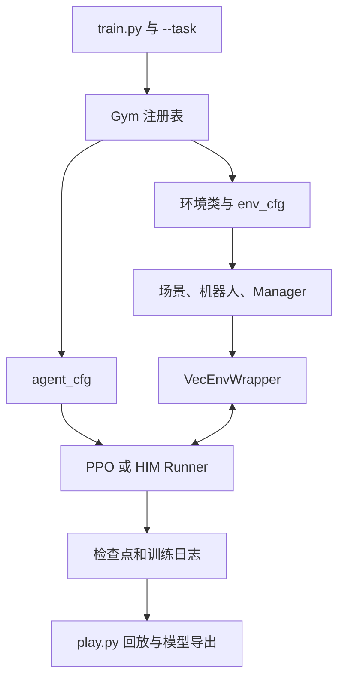

# AT_robot_lab 项目逻辑导读：以 Go2 和 CSDog1 为例

本文依据当前仓库源码整理，帮助首次接触 Isaac Lab 的读者定位代码。用户提到的 casdog1 在代码中的名称是 **csdog1 / CSDog1**。

## 1. 先理解整个项目在做什么

本项目在 Isaac Lab 上定义机器人强化学习任务。以速度跟踪为例：输入期望的前进、侧移和转向速度，策略输出 12 个关节动作，让四足机器人尽量跟随指令，同时保持稳定、减少能耗和冲击。

可以分成四层：

| 层次 | 负责什么 | 本项目对应位置 |
| --- | --- | --- |
| Isaac Sim / PhysX | 场景、碰撞、刚体动力学、仿真计算 | 外部安装的仿真平台 |
| Isaac Lab | 机器人接口、并行环境、传感器、各类 Manager | 外部 `isaaclab` 包 |
| Robot Lab 任务 | 具体机器人、地形、观测、动作、奖励、随机化 | `source/robot_lab/robot_lab/` |
| 强化学习算法 | 采样、Actor/Critic、PPO 更新、检查点 | RSL-RL 等外部库，以及本地 `him/` |

**环境定义“机器人面对什么问题”，算法定义“怎样学会解决问题”。** 环境配置和 PPO 配置是两套独立配置，在启动脚本里组合。



## 2. 目录地图

以下路径相对仓库根目录：

```text
scripts/
  reinforcement_learning/rsl_rl/
    train.py                     # 训练入口
    play.py                      # 推理、回放和导出入口
    play_cs.py                   # 另一份回放脚本；当前迁移说明使用 play.py
    cli_args.py                  # RSL-RL 命令行参数
  tools/                         # 环境检查、迁移验证等工具
source/robot_lab/
  data/                          # 本地 USD 等机器人模型资源
  robot_lab/
    assets/                      # Python 机器人资产配置
      unitree.py                 # 包括 UNITREE_GO2_CFG
      csdog1.py                  # CSDOG1_CFG
    terrains/                    # 项目自定义地形
    him/                         # HIM 网络、估计器、PPO、包装器、导出
    tasks/
      __init__.py                # 自动导入子包，触发环境注册
      manager_based/
        locomotion/velocity/
          velocity_env_cfg.py    # 通用速度跟踪环境配置
          mdp/                   # 自定义观测、奖励、事件、指令等函数
          config/quadruped/
            unitree_go2/         # Go2 任务注册、环境配置、算法配置
            csdog1/              # CSDog1 任务注册、环境配置、算法配置
              cyberstar/         # 迁移任务的独立运行时与仿真适配
        beyondmimic/             # 另一类运动跟踪任务
      direct/                    # 直接编写环境逻辑的任务，如 G1 AMP
logs/                            # 训练检查点、配置及日志
outputs/                         # 检查脚本输出等产物
```

`assets/*.py` 是“如何加载和驱动机器人”的配置，不是模型几何文件本身。资产路径由 `assets/__init__.py` 定位到 `source/robot_lab/data/`。

## 3. ManagerBased 是什么

标准 Go2 环境没有在本仓库实现一套完整 `step()`；它使用 Isaac Lab 的 `ManagerBasedRLEnv`，通过配置装配各项功能。

| 配置成员 | 作用 | 例子 |
| --- | --- | --- |
| `scene` | 场景、地形、机器人、传感器 | robot、contact_forces、height_scanner |
| `commands` | 生成任务目标 | 期望 vx、vy、yaw 速度 |
| `observations` | 组织网络输入 | 角速度、重力投影、关节状态、上一步动作 |
| `actions` | 把网络输出变成控制目标 | 关节位置偏移 |
| `rewards` | 给行为打分 | 跟踪速度奖励、能耗和打滑惩罚 |
| `terminations` | 判定结束或超时 | 接触失败、姿态失败、20 s 超时 |
| `events` | 启动、重置、定时执行的操作 | 摩擦随机化、重置姿态、推扰 |
| `curriculum` | 随训练推进改变难度 | 地形难度、指令范围 |

`ObsTerm(func=..., scale=...)` 指定如何算一个观测；`RewardTermCfg(func=..., weight=...)` 指定如何算一个奖励。`SceneEntityCfg` 负责选择机器人、关节或刚体。这里的 `mdp` 是这些任务函数的集合。

`@configclass` 是 Isaac Lab 的配置类机制。子类一般先调用 `super().__post_init__()`，再覆盖父类参数，因此**最终配置需要沿继承链阅读**。将某项设为 `None` 通常表示移除该项；本项目还会用 `disable_zero_weight_rewards()` 移除零权重奖励。

## 4. 从训练命令到机器人运动

以 Go2 为例：

```bash
# 使用已安装 Isaac Lab 和本项目的 Python 环境
python scripts/reinforcement_learning/rsl_rl/train.py \
  --task RobotLab-Isaac-Velocity-Flat-Unitree-Go2-v0 \
  --num_envs 2048 --headless
```

启动过程：

1. `train.py` 解析命令行，通过 `AppLauncher` 启动 Isaac Sim。
2. `import robot_lab.tasks` 递归导入任务包，各机器人目录的 `__init__.py` 执行 `gym.register()`。
3. `@hydra_task_config(args_cli.task, args_cli.agent)` 从注册表取得环境和算法配置，并应用覆盖参数。
4. `gym.make(task, cfg=env_cfg)` 创建环境、机器人和管理器。
5. 普通 PPO 使用 `RslRlVecEnvWrapper`，HIM 使用 `HIMVecEnvWrapper`，把环境接口接到算法。
6. 根据 `agent_cfg.class_name` 创建 `OnPolicyRunner` 或 `HIMOnPolicyRunner`，按需加载检查点。
7. `runner.learn()` 交替执行环境采样和网络更新，保存日志、模型及配置。

从控制角度看，每次交互形成如下闭环：

```text
观测 + 速度指令 → Actor → 12维动作 → 关节目标 / PD力矩
       ↑                                      ↓
       └──────── 机器人状态和传感器 ← 物理仿真
                           ↓
                      奖励、结束判定
                           ↓
                  采样缓存 → PPO更新网络
```

这是功能示意；Cyberstar 分支还专门控制状态同步、奖励、重置和历史更新的执行顺序。

通用配置为 `sim.dt=0.005`、`decimation=4`：物理仿真 **200 Hz**，策略每 4 个物理步更新一次，即 **50 Hz / 20 ms**。默认 4096 个并行环境、单回合 20 s，命令行可覆盖环境数。

`num_steps_per_env` 是每轮更新前每个环境采多少步，`max_iterations` 是训练更新轮数。它们都不等于物理仿真步数。

## 5. Go2：最适合先读的标准路线

阅读链路：

```text
unitree_go2/__init__.py
  → UnitreeGo2FlatEnvCfg                    flat_env_cfg.py
    → UnitreeGo2RoughEnvCfg                 rough_env_cfg.py
      → LocomotionVelocityRoughEnvCfg       velocity_env_cfg.py
        → ManagerBasedRLEnvCfg              Isaac Lab
```

- 注册文件把 task ID 映射到环境类、环境配置和算法配置。Go2 Flat/Rough 的环境类都是 `isaaclab.envs:ManagerBasedRLEnv`。
- 通用配置定义任务骨架；Go2 Rough 配置替换机器人资产、关节顺序、传感器绑定、动作缩放和奖励权重。
- Go2 Flat 继承 Rough，再把地形切成平面，关闭地形扫描观测和地形课程。因此“Flat 继承 Rough”是代码复用关系。
- `agents/rsl_rl_ppo_cfg.py` 配置 PPO 网络及训练参数。当前 Actor/Critic 隐藏层都是 `[512,256,128]`，Flat 默认 5000 轮，Rough 默认 20000 轮。

Go2 Actor 去掉了真实基座线速度和高度扫描，输入是：

```text
角速度3 + 重力投影3 + 速度指令3 + 相对关节位置12
+ 关节速度12 + 上一步动作12 = 45维
```

Critic 用于训练时估计价值，可以看到额外信息，例如真实线速度；Rough 的 Critic 还保留地形扫描。Actor 是部署时真正输出动作的网络。

动作表示相对默认姿态的偏移，而非直接力矩：

```text
q_target = q_default + action_scale * action
```

Go2 髋关节 scale=0.125，其他关节 scale=0.25，配置中的动作裁剪为 ±100。随后由执行器根据关节目标产生力矩。关节顺序为 **FR、FL、RR、RL**，每条腿 hip/thigh/calf。

## 6. CSDog1：需要区分两条路线

### 6.1 普通 Flat / Rough / Flat282

这些任务仍使用标准 `ManagerBasedRLEnv`：

```text
LocomotionVelocityRoughEnvCfg
  → CSDog1RoughEnvCfg
    → CSDog1FlatEnvCfg
      → CSDog1Flat282EnvCfg
```

与 Go2 相比，CSDog1 增加了步态相位、自定义动作裁剪和停步相位逻辑，并对齐部署侧观测约定。

| 项目 | Go2 标准任务 | CSDog1 普通任务 |
| --- | --- | --- |
| 关节顺序 | FR、FL、RR、RL | FL、FR、RL、RR |
| Actor 单帧 | 45维 | 47维，额外2维 sin/cos 相位 |
| 动作缩放 | 髋0.125，其他0.25 | 全部0.25 |
| 基座名称 | `base` | `base_link` |
| 足端接触选择 | `.*_foot` | `.*_calf` |
| 默认关节角 | 见 `assets/unitree.py` | `[0,0.785,-0.623]` / 腿 |

47维的排列为：

```text
phase2 → ang_vel3 → gravity3 → commands3
→ joint_pos12 → joint_vel12 → previous_action12
```

`Flat282` 表示 **47维 × 6帧历史 = 282维**，不是 282 个关节或动作。普通任务的相位、动作和观测细节在 `csdog1/observations.py`，部署约定见同目录 `README.md`。

### 6.2 DomainRand / Stairs：Cyberstar 迁移路线

这两个注册任务分别使用自定义环境类：

| task ID | 实际环境入口 | 实际配置 |
| --- | --- | --- |
| `RobotLab-Isaac-Velocity-Flat-CSDog1-282-DomainRand-v0` | `cyberstar.lab:CSDog1CyberstarEnv` | `cyberstar/env_cfg.py` |
| `RobotLab-Isaac-Velocity-Stairs-CSDog1-282-v0` | `cyberstar.stairs_lab:CSDog1CyberstarStairsEnv` | `stairs_env_cfg.py` |

它们仍继承 ManagerBased 框架，但通过 `cyberstar/` 迁移完整训练语义：

- `config.json` / `stairs_config.json`：训练参数及奖励权重。
- `core.py` / `stairs_core.py`：张量形式的任务逻辑、奖励与状态机。
- `runtime.py` / `stairs_runtime.py`：运行时状态和配置适配。
- `lab.py` / `stairs_lab.py`：接入 Isaac Lab 的状态读取、动作、重置、奖励和执行顺序。
- `asset.py`：在场景加载时恢复独立 FOOT 刚体，区分脚接触与小腿碰撞。
- `terrain.py` / `stairs_terrain.py` 等：迁移地形与台阶生成。

**不要只读 `flat_env_cfg.py` 里同名的 `CSDog1Flat282DomainRandEnvCfg` 来判断当前注册 DomainRand 任务。注册表实际指向 `cyberstar/env_cfg.py`。**

迁移路线与普通 CSDog1 的主要差异：

| 项目 | 普通 Flat47 / Flat282 | 当前迁移 DomainRand / Stairs |
| --- | --- | --- |
| 默认 calf 角 | -0.623 | -0.823 |
| 指令缩放 | `[1,1,0.25]` | `[2,2,0.25]` |
| Actor | 47维或6帧282维 | 完整帧历史282维 |
| Critic | 常规任务观测 | 491维特权观测 |
| 停步相位 | 固定延时停相位 | 接触与测量状态驱动的停车状态机 |
| 控制实现 | 关节位置动作配合执行器 | 每个物理步显式计算PD，含延迟和电机强度 |
| 奖励合成 | 标准管理器加权方式 | 自定义 Ji22 正负奖励合成 |

491维 Critic 包含干净历史、真实线速度、接触力、动力学随机化信息、停车状态和地形高度等。地形信息供 Critic 训练使用，Actor 仍是本体历史输入，台阶任务属于盲走策略。

该分支的详细合同、权重迁移规则和台阶调整见 [CSDOG1_MIGRATION.md](CSDOG1_MIGRATION.md)。

## 7. HIM 与 PPO 的关系

HIM 不是另一套物理环境。它是在 PPO 训练上增加历史状态估计的策略结构，本项目实现在 `robot_lab/him/`。

```text
6帧历史282维 → HIMEstimator → 估计速度 + latent特征
                                ↓
当前帧47维 ────────────────→ Actor → 12维动作
特权观测 ──────────────────→ Critic → 价值估计
```

对应文件：`him_actor_critic.py` 定义网络组合，`him_estimator.py` 定义估计器，`him_ppo.py` 执行 PPO 和估计器更新，`him_on_policy_runner.py` 组织采样训练，`him_vec_env_wrapper.py` 整理输入，`exporter.py` 导出部署模型与元数据。

`HIMVecEnvWrapper` 有一个关键作用：Isaac Lab 普通历史可能按观测项展开，而部署要求按完整帧排列。它把普通 CSDog1 的历史重排为**旧帧到新帧**；Cyberstar 环境已经输出正确的完整帧历史，因此直接保留。

注册表中 CSDog1 的 Flat282、DomainRand、Stairs 默认 `rsl_rl_cfg_entry_point` 都选择 HIM，普通 Flat/Rough 默认选择 PPO。282任务另注册了 `rsl_rl_ppo_cfg_entry_point`，可以通过 `--agent` 显式选择普通 PPO；维度相同不代表网络结构和输入布局可以互换。

## 8. 训练、回放和部署的关系

```text
训练：环境 + 随机化 + Actor/Critic + PPO更新 → model_*.pt
回放：环境 + checkpoint + 推理策略 → 观察机器人行为
导出：checkpoint → policy.pt / policy.onnx + 部署元数据
实机：传感器和指令 → 相同观测预处理/历史 → 导出策略 → 电机控制
```

Go2 回放示例：

```bash
python scripts/reinforcement_learning/rsl_rl/play.py \
  --task RobotLab-Isaac-Velocity-Flat-Unitree-Go2-v0 \
  --checkpoint /absolute/path/to/model.pt --num_envs 1
```

CSDog1 普通历史任务训练示例：

```bash
python scripts/reinforcement_learning/rsl_rl/train.py \
  --task RobotLab-Isaac-Velocity-Flat-CSDog1-282-v0 \
  --num_envs 2048 --headless
```

迁移 DomainRand 默认从 flat282 `model_1000.pt` 续训；Stairs 默认从 DomainRand `model_2000.pt` 续训。路径配置在 `agents/rsl_rl_him_cfg.py`，可用 `--checkpoint` 指定。默认文件是否存在需以本地实际文件为准。当前普通 Flat282 与迁移分支合同存在差异，不能仅凭“282维”认定旧检查点可等价接续；迁移加载器会检查并转换支持的源格式，详见迁移文档。

导出不代表实机输入已自动适配。关节顺序、默认角、单位、缩放、裁剪、历史方向、策略周期和停车状态机都要与训练保持一致。特别是普通 CSDog1 和迁移任务不能直接共享同一份部署配置。

## 9. 建议的阅读和修改顺序

1. 先看 `unitree_go2/__init__.py`：理解 task ID 如何选择环境和算法。
2. 看 `unitree_go2/flat_env_cfg.py`、`rough_env_cfg.py`：理解继承覆盖。
3. 看 `velocity_env_cfg.py`：逐项对上 scene / observations / actions / rewards 等配置。
4. 看 `assets/unitree.py` 和 `mdp/`：理解模型与任务函数。
5. 看 `train.py` 创建环境、包装器、Runner 和 `learn()` 的部分。
6. 再看 `csdog1/rough_env_cfg.py`、`observations.py`、`flat_env_cfg.py`：理解47维和282维。
7. 最后看 `csdog1/__init__.py` 的迁移入口，再进入 `cyberstar/` 与 `him/`。

| 想修改什么 | 优先查看 |
| --- | --- |
| 模型路径、力矩限制、执行器 | `assets/*.py`；迁移任务也检查 `cyberstar/asset.py` 和 `lab.py` |
| Go2观测、动作、奖励 | Go2 `rough_env_cfg.py` 及通用 `velocity_env_cfg.py` |
| 普通CSDog1输入和相位 | `csdog1/rough_env_cfg.py`、`observations.py` |
| 迁移任务奖励、停车、推扰 | `cyberstar/config.json`、`core.py`；台阶对应 `stairs_*` |
| 台阶高度、比例和指令 | `stairs_config.json`、`stairs_env_cfg.py`、台阶运行时 |
| 网络、学习率、续训路径 | 对应 `agents/`；HIM实现位于 `robot_lab/him/` |
| 并行数量、训练轮数 | 启动参数 `--num_envs`、`--max_iterations` |

本文为源码结构梳理，没有重新运行训练或仿真，不对当前检查点的步态效果作判断。
